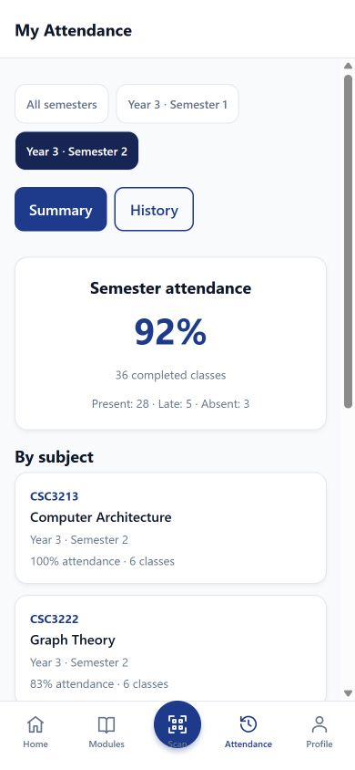

# Smart Attendance

An undergraduate portfolio project by [tniketha](https://github.com/tniketha).

React Native / Expo · JavaScript · Express · MongoDB

The demonstration uses **University of Vavuniya, Faculty of Applied Science**, fictional student Nikky and lecturer Ms. Niketha, and twelve Year 3 Computer Science modules across Semesters 1 and 2.

## What the app does

- Students and lecturers sign in with an email or institutional ID.
- Lecturers select a semester and module, set the class duration and display its QR code.
- Enrolled students scan the code to record present or late attendance, once per class.
- Lecturers refresh the attendance list when needed and end the class to mark missing students absent.
- Students view semester statistics and filtered history together in My Attendance.
- Lecturers view module reports, export CSV files and access their account details from the dashboard.

## Project structure

| Folder           | Purpose                                                |
| ---------------- | ------------------------------------------------------ |
| `src/screens`    | Student, lecturer and sign-in screens.                 |
| `src/components` | Shared buttons, cards, QR display and camera controls. |
| `src/api`        | Requests from the app to the API.                      |
| `src/store`      | Sign-in state.                                         |
| `server/src`     | Routes, controllers and attendance rules.              |
| `server/data`    | Fictional demo names and semester modules.             |
| `server/tests`   | Tests for the core attendance workflow.                |
| `assets`, `docs` | Branding and current portfolio screenshots.            |

A useful interview explanation is: **screen → API request → route/controller → database → response → updated screen**. Follow one student check-in through those steps.

## Run locally

Use Node.js 22, npm and MongoDB 8. The database needs a replica set for the attendance transactions. From the project root:

```powershell
npm install
npm --prefix server install
node server/scripts/start-local-db.cjs
```

Copy `server/.env.example` to `server/.env` if it does not exist. Its default database URL matches the local database helper. Then:

```powershell
cd server
npm run dev
```

In a second terminal, from the project root:

```powershell
$env:EXPO_PUBLIC_API_URL='http://localhost:5000/api'
npm run web
```

Use `npm run android` or `npm run ios` for native development. A physical phone needs the API computer's LAN address. Browser camera access requires HTTPS outside localhost. Native builds require the corresponding platform tooling.

## Demo accounts

Seed only a disposable demo database: this command resets its demo collections.

```powershell
cd server
$env:ALLOW_DEMO_RESET='true'
npm run seed
```

| Role                 | Identifier                   | Password    |
| -------------------- | ---------------------------- | ----------- |
| Student Nikky        | STU001                       | password123 |
| Lecturer Ms. Niketha | niketha@lecturer.example.com | password123 |

The shared dataset is `server/data/demo-data.json`. Names and addresses are fictional. For screenshots with attendance records, follow the [gallery instructions](docs/screenshots/README.md).

## Screenshots

| Sign in                                                                     | Student dashboard                                                                               | Semester statistics                                                                                |
| --------------------------------------------------------------------------- | ----------------------------------------------------------------------------------------------- | -------------------------------------------------------------------------------------------------- |
|  |  |  |

[Full gallery](docs/screenshots/README.md) · [Portfolio explanation](docs/PORTFOLIO.md)

## Checks

```powershell
npm run check
node server/scripts/start-local-db.cjs --test
npm --prefix server test
```

Tests use only the dedicated `attendance_security_test` database and remove their own records. `npm run build:web` checks the web bundle.

## Attendance rules

Percentages count present plus late records divided by all completed records. Active classes are excluded. A student enrolled after a class started cannot check in to that class. The QR code works only while the class is active; it does not prove physical presence. Sign-in tokens expire after eight hours, and logout revokes the current token.

This is a demonstration application. Set a random `JWT_SECRET` and an HTTPS API address before hosting it publicly. Keep private configuration and database files out of Git.
