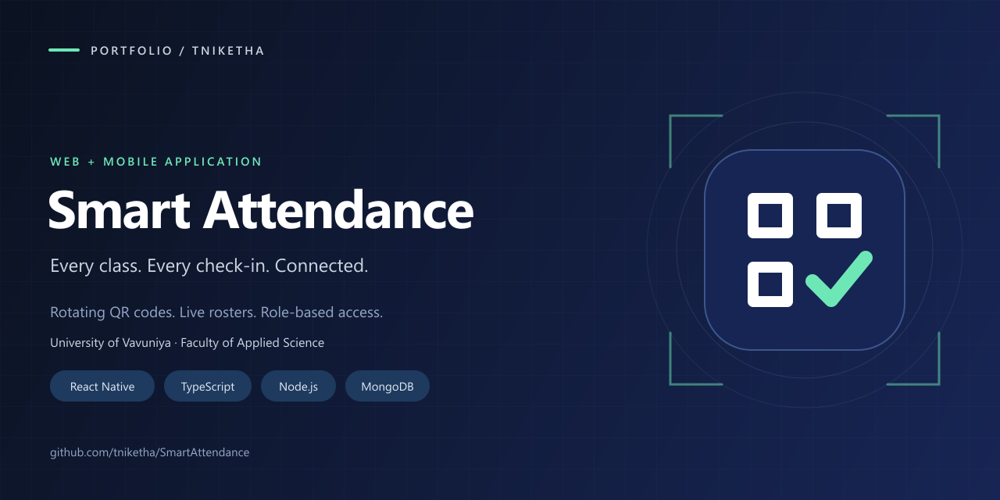
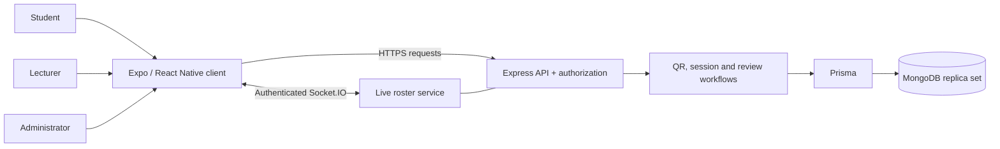

# Smart Attendance · Portfolio case study

**Author:** [tniketha](https://github.com/tniketha)

**Repository:** [SmartAttendance](https://github.com/tniketha/SmartAttendance)

**Project type:** Full-stack university attendance application targeting web, Android and iOS.

**Demo setting:** University of Vavuniya, Faculty of Applied Science. Fictional users include student Nikky and lecturer Ms. Niketha; twelve Year 3 Computer Science courses span Semesters 1 and 2. See the [demo context and curriculum source](DEMO_CONTEXT.md).

Browse the [11 app screenshots](screenshots/README.md), including mobile layouts, light/dark themes, lecturer tools, reports and the administrator audit view. All captures use fictional demonstration records.

## Project overview

Smart Attendance brings student check-ins, lecturer session management and administrative oversight into one application. Students scan a rotating classroom QR code; the API verifies the account, enrollment, session and configured location rules before recording attendance. Lecturers see roster updates and handle correction requests, while students track their attendance over time.

## Skills demonstrated

| Skill | Implementation evidence |
| --- | --- |
| Cross-platform frontend | React Native and Expo, typed navigation, reusable components, responsive layouts, and light/dark themes in `src/`. |
| API design and authorization | Express routes, Zod validation, authentication middleware, role checks and lecturer ownership checks in `server/src/`. |
| Database modeling | Prisma models for users, enrollments, modules, sessions, records, reviews and audit logs in `server/prisma/schema.prisma`. |
| Data consistency | Transactional check-in/session closure and review/audit updates in the session service and controllers. |
| Real-time applications | Authenticated Socket.IO roster updates with polling recovery. |
| Authentication lifecycle | Short-lived access tokens, hashed rotating refresh tokens and account-session revocation. |
| Device integration | Camera-based QR scanning, location checks and mobile CSV sharing. |
| Security testing | Integration scenarios for authorization, replay, concurrency, location validation and token rotation in `server/tests/security.cjs`. |
| Product presentation | A shared app logo, platform icon assets, accessible labels, error/retry states and project documentation. |
| Academic data presentation | Semester selectors, course/year labels and attendance totals recalculated for the selected term. |

## Architecture

## Engineering decisions to discuss

**Validate check-ins on the server.** A scanned QR is an input to validation. The server also checks token validity, enrollment, session state and optional location requirements before accepting a record.

**Handle concurrent actions.** Session closure can happen while students are scanning. Transactions and duplicate prevention protect attendance records, and expired sessions are recovered after restart. MongoDB therefore requires a replica set, including in local development.

**Recover from a dropped live connection.** Lecturer rosters use authenticated sockets with polling recovery so a temporary disconnect does not leave the screen permanently stale.

**Keep correction history.** Lecturer-approved changes and their audit records commit together. A correction is a controlled workflow rather than an unexplained overwrite.

**Be explicit about limitations.** QR rotation and location validation reduce common abuse, but a relayed code or modified client can still defeat assumptions about physical presence. See the [security review](../SECURITY_REVIEW.md). Production SSO, password recovery and institutional provisioning remain future work.

## Suggested demonstration walkthrough

Use a disposable, seeded database following the [setup instructions](../README.md#development-setup). Use separate browsers or browser profiles for student and lecturer accounts. The app permits one active sign-in per account.

1. Show the branded sign-in screen and explain the three roles.
2. Sign in as a lecturer, choose a module and start an attendance session.
3. Sign in as a student and scan the current QR on another device. Camera/location permissions and a reachable API are required; web device access requires HTTPS outside localhost.
4. Show the lecturer roster update, then close the session.
5. Show student history/insights and the attendance correction workflow.
6. Show a report export and explain the server-side checks behind the workflow.

If recording on one computer without camera/location access, demonstrate history, reports and review flows and explain the device-based check-in separately. Use synthetic records in screenshots and recordings.

## Portfolio description

> Smart Attendance is a full-stack university attendance application built with React Native, Expo, TypeScript, Express, Prisma and MongoDB. It connects rotating QR check-ins with live lecturer rosters, attendance analytics and audited correction requests. The project demonstrates cross-platform UI development, role-based authorization, transactional data workflows, real-time communication and security-focused integration testing.

## Evidence and next steps

- The repository contains the implementation and test scenarios. Run the documented checks before claiming a passing test suite; test coverage alone does not establish production readiness.
- The target platforms are web, Android and iOS. Native signing, installation and real-device acceptance are separate from an Expo bundle export.
- This case study makes no adoption, performance or attendance-improvement claims. Add measured outcomes only after collecting evidence.
- The project cover can be reused as a portfolio thumbnail or uploaded to the repository's social-preview settings. It is artwork, not a screenshot of a dashboard.
