# Portfolio screenshot gallery

Actual screenshots of Smart Attendance, captured on **22 October 2026** using a separate local `smart_attendance_portfolio` database. All student names, IDs, attendance records and the audit example are synthetic demo fixtures. The QR code belongs to a temporary demo session and expires.

This is the current screenshot set: University of Vavuniya, Faculty of Applied Science, Nikky, Ms. Niketha and semester-based Computer Science courses. Screenshots replace the earlier generic demo in place; see the [demo context](../DEMO_CONTEXT.md) for course sources and semester behavior.

The mobile images show the web app at a **390 × 844** browser viewport. Desktop captures use **1280 × 720**. They demonstrate responsive web layouts; they are not photographs or native device captures. Screenshots preserve the UI as rendered.

## Student experience

| Sign in | Dashboard | Attendance insights |
| --- | --- | --- |
| 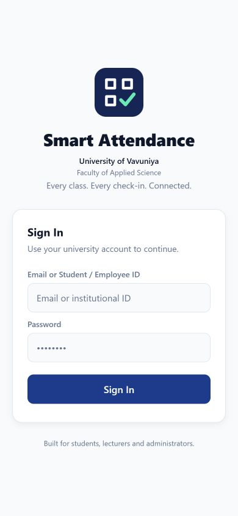 | 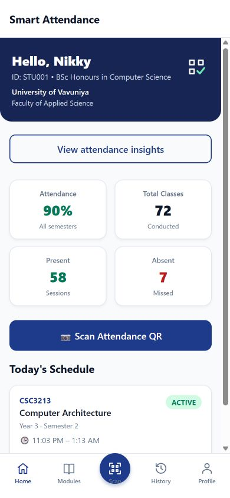 | 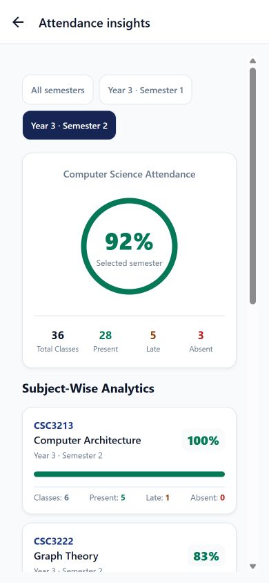 |

| Enrolled modules | Dark dashboard |
| --- | --- |
| 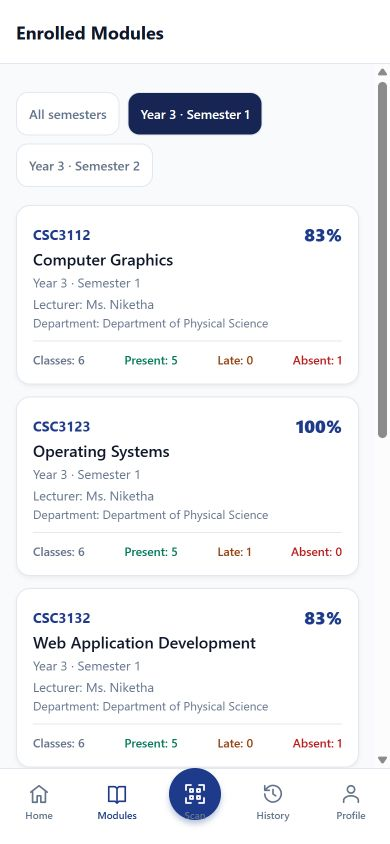 | 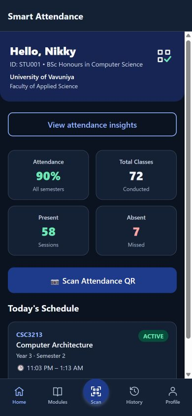 |

## Lecturer dashboard

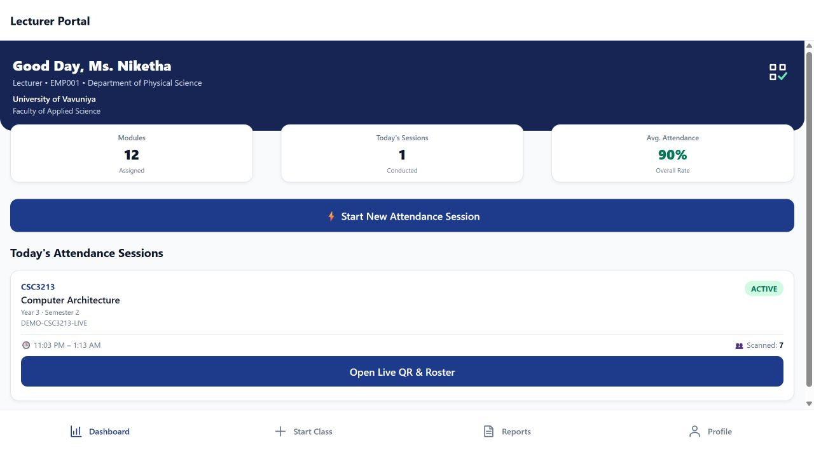

## Rotating QR attendance

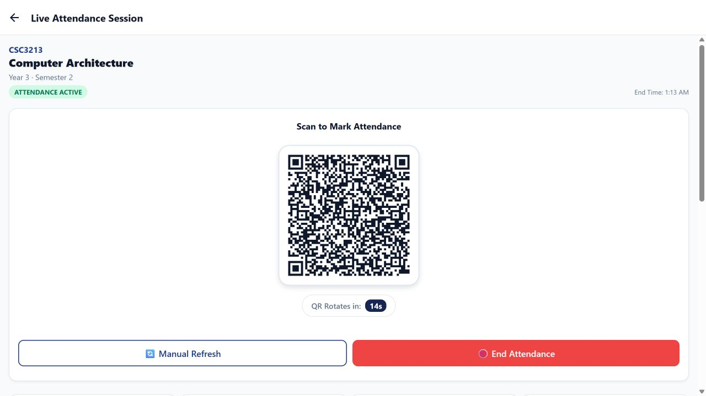

## Live roster

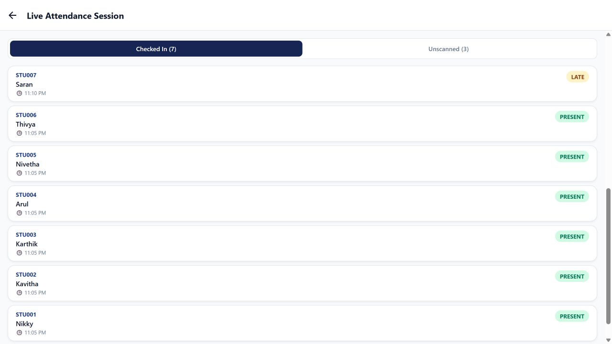

## Reports

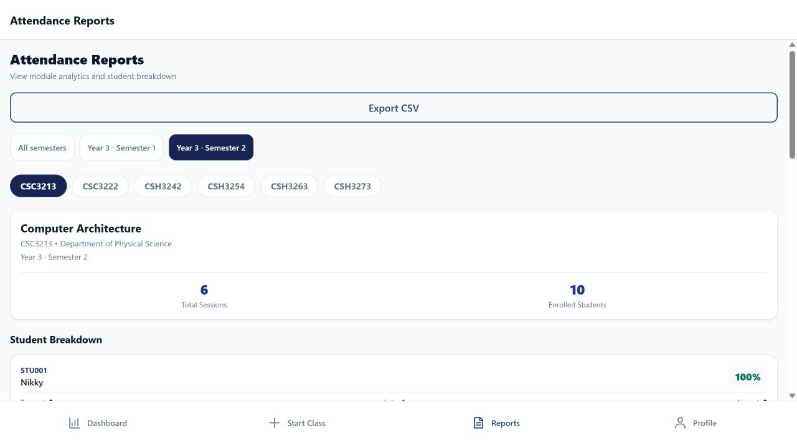

## Administration and audit trail

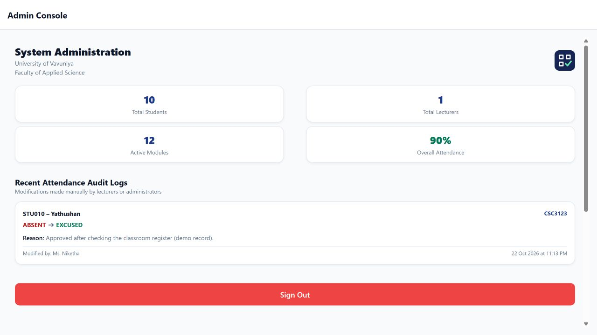

## Dark sign-in

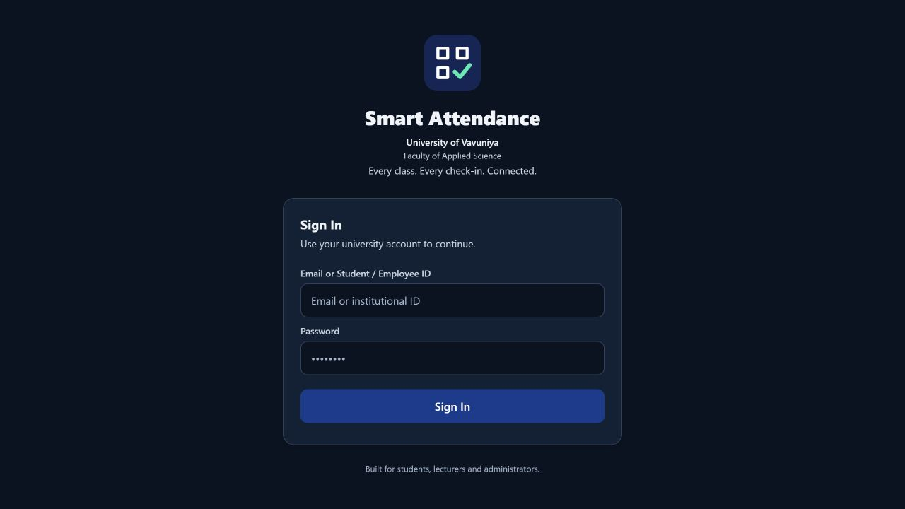

## Recreate the demo data

Use the [local replica-set setup](../../README.md#development-setup) and create a separate database named exactly `smart_attendance_portfolio`. The fixture script refuses other database names, remote hosts and production mode. It **resets all demo data in that named database**.

From the repository root, after starting the local database helper on port 27018:

```powershell
$env:NODE_ENV='development'
$env:DATABASE_URL='mongodb://127.0.0.1:27018/smart_attendance_portfolio?replicaSet=attendance-local'
$env:ALLOW_DEMO_RESET='true'
node server/node_modules/prisma/build/index.js db push --schema server/prisma/schema.prisma --skip-generate
node tools/seed-portfolio.cjs
```

Pass that same `DATABASE_URL` when starting the API; do not point the API at another database. Configure the frontend API URL and allowed web origin as described in the project README. For local screenshots use the development preview; release builds require an HTTPS API URL.

The script creates ten fictional students, twelve Computer Science modules, seventy-two completed sessions across Semesters 1 and 2, one active session and a sample correction audit entry. Log in as `STU001` (Nikky), `niketha@lecturer.example.com` (Ms. Niketha) or `admin@example.com` (Tharshini) with the local demo password `password123`. The live session lasts two hours; reset the disposable demo again if it expires. Never use these accounts or credentials for deployment.

For your portfolio, start with the [project cover](../../assets/brand/portfolio-cover.png), student dashboard and live QR screen. Add analytics and the audit screenshot when discussing data workflows and authorization. The full [case study](../PORTFOLIO.md) provides supporting technical context.
