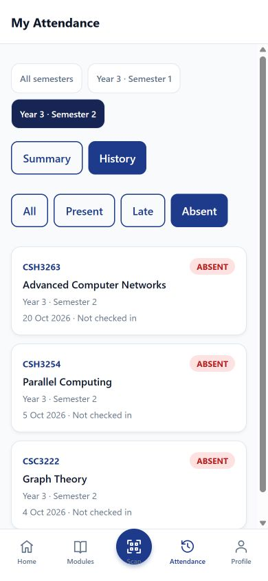
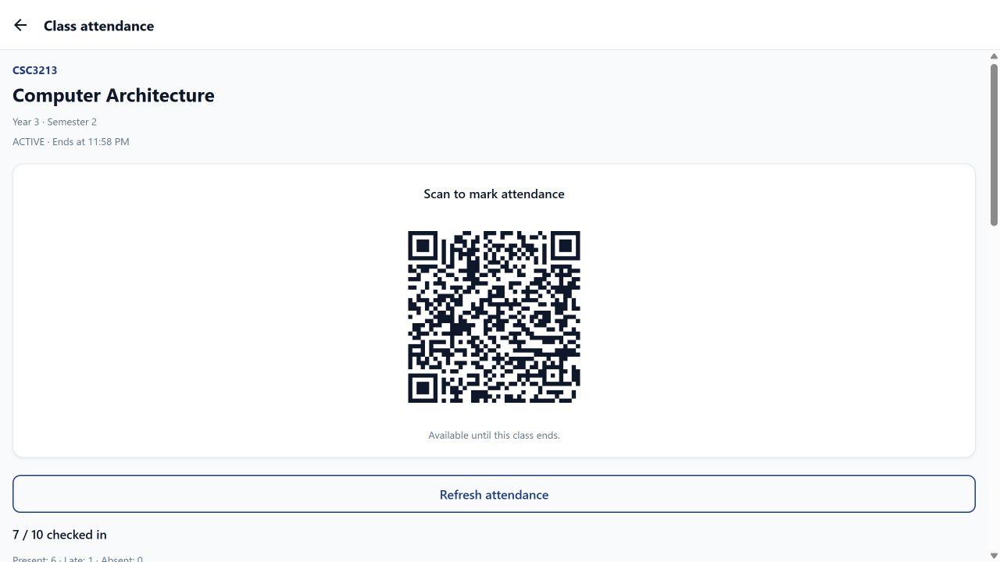
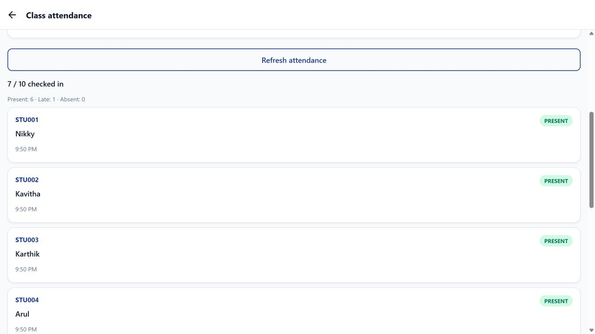

# Smart Attendance screenshots

Current app captures using fictional Nikky, Ms. Niketha and University of Vavuniya demo data. Mobile captures use a 390 × 844 web viewport; desktop captures use 1280 × 720. These are browser screenshots.

## Student screens

| Sign in                                                    | Dashboard                                                                      | Semester summary                                                                    |
| ---------------------------------------------------------- | ------------------------------------------------------------------------------ | ----------------------------------------------------------------------------------- |
|  |  |  |

| Attendance history                                                               | Enrolled modules                                                            |
| -------------------------------------------------------------------------------- | --------------------------------------------------------------------------- |
|  |  |

## Lecturer dashboard and account details


## Class QR code



## Attendance list



## Module report


## Create screenshot data

Start the local database helper from the root README. Then use a separate, disposable database:

```powershell
$env:DATABASE_URL='mongodb://127.0.0.1:27018/smart_attendance_portfolio?replicaSet=attendance-local'
$env:ALLOW_DEMO_RESET='true'
node tools/seed-portfolio.cjs
```

Start the API with the same `DATABASE_URL`. The seed resets only the named local portfolio database. It creates ten students, twelve modules, six completed classes per module and one active class. Use STU001 or niketha@lecturer.example.com with password123. The active class lasts two hours.
